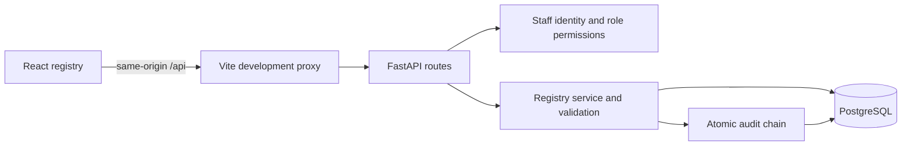

# Architecture

Implemented: patient/guardian identity, aliases, allergy review, masked searches, duplicate review,
optimistic revisions, immutable versioned background responses and access/change audit evidence.
See ADR-002 for transaction, search and auth decisions.

The browser never receives database credentials. API permissions and all patient queries use the
principal's clinic ID; clients cannot choose a clinic ID in registration requests. Development uses
an explicit synthetic staff key, with loopback servers. Production configuration requires managed OIDC
and forbids development credentials. Live IdP integration and browser OIDC login remain unfinished.

Search inputs are sent in POST bodies; no analytics, external fonts or AI calls are configured.
Tokens live only in browser memory. Server errors omit supplied input values; configuration repr hides credentials.

Private documents, encounters, clinical rules, notifications, parent access and AI remain planned.
No prescribing, growth reference calculations or vaccination recommendations exist. TLS/encryption,
restricted DB role, external audit integrity, backup/restore, privacy review and clinical sign-off remain release gates.
