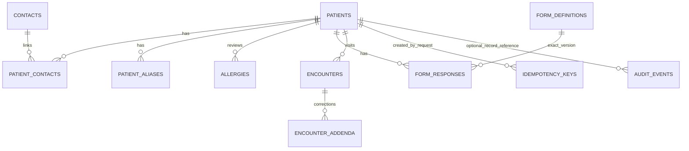

# Implemented registry relationships

Patient/contact/alias/allergy/response/idempotency foreign keys include clinic scope.
Audit record references are logical and may be absent for search/access events. The audit table is
clinic-scoped; snapshots preserve changes even when an editable profile is replaced.
Encounters contain structured note/raw observation JSON and historical birth context; audit preserves
draft replacements. Other clinical modules from the baseline remain planned.
