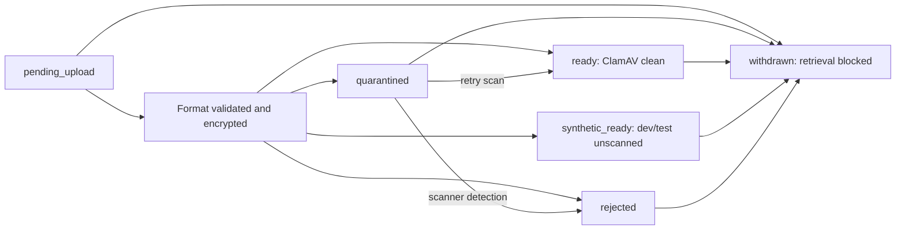

# Unit 03 — documents and investigations

Use the Documents and Investigations tabs inside a patient record. This unit adds private attachment
storage/retrieval, investigation request tracking, attributed results and append-only corrections.
The local preview remains `http://127.0.0.1:5174/`. All development content must be fictional.

## Building sequence and data flow

1. Reviewed Steps 006–008, baseline M3, existing authentication, audit, versioning and migrations.
2. Added migration 004: documents with encrypted content/lifecycle, immutable scan records,
   versioned investigation orders and immutable linked results/corrections.
3. Added config and file services for stable AES-GCM keys, bounded format checks, ClamAV INSTREAM
   and explicit synthetic development state. Missing/inconclusive malware scanning blocks retrieval.
4. Added scoped transactional services and routes; writes/access evidence use the existing audit chain.
5. Added two-stage upload: create retry-safe metadata, then stream at most 10 MiB. Metadata persists
   after interrupted upload; retry original fields/file or withdraw it. Byte replacement is rejected.
6. Added short-lived signed download tickets plus current authentication; decrypt/authenticate/hash
   original bytes before returning them. Ticket issuance and downloads have separate audit evidence.
7. Added request/status/result/correction APIs. Explicit If-Match protects status/lifecycle changes;
   UUID keys prevent duplicate create/result records. Patient/clinic links are checked on the server.
8. Built browser document lists/forms/viewer and investigation forms/history, with source metadata,
   local-time inputs, explicit release states, reason prompts, pagination and unsaved guards.
9. Generated contracts; added PostgreSQL, encryption/parser/protocol and browser acceptance checks.
   Added a generated fictional sample image and desktop/mobile evidence; updated design/maintenance docs.

## Where to modify behavior

| Concern | Owning files | Modification guidance |
| --- | --- | --- |
| Input fields, units, date constraints | `records/schemas.py`, shared `records.ts` | Update server validation and frontend type/form together; never add invented ranges. |
| Format policy, scanning and crypto | `records/files.py`, config, pinned dependencies | PDF is restricted to static nonencrypted content; images verify/decode with a pixel cap. Keep scanner fail-closed behavior. |
| Transactions/lifecycle/replay | `records/service.py` | Preserve old ciphertext and result snapshots. Permissions, linked records, reasons and audit must remain atomic. |
| Routes and upload/download controls | `records/routes.py` | Keep bounded streaming, authenticated POST tickets/downloads, generated filenames and safe response headers. |
| Role rules | `auth.py` | Registrar attachments/read-investigations; clinician/admin write investigations. Permission changes need security tests. |
| Tables and triggers | `004_documents_investigations.sql` | It is now applied; add a new migration rather than rewriting it. |
| Screens and navigation | `Documents.tsx`, `Investigations.tsx`, `PatientOverview.tsx`, `App.tsx`, CSS | Keep source fields, missing values, history and scanning state visible; guard unsaved entries. |
| Setup/key handling | config, `.env.example`, launcher/runbook/CI | Preserve the existing key across restarts. Do not commit runtime keys or replace them to fix access errors. |
| Contracts | OpenAPI YAML/JSON and `records.ts` | Run `scripts/export-openapi.py`, typecheck and contract tests after backend changes. |
| Regression evidence | tests and screenshots below | Extend meaningful lifecycle/isolation/parser/encryption/browser cases when changing behavior. |

The `records` backend directory is `services/api/src/clinic_api/records`; shared types are in
`packages/shared-contracts`, and screens are in `apps/web/src`.

## Lifecycle and historical behavior

Metadata and original file bytes are immutable once uploaded. Scan retries/withdrawal advance
document versions and append audit/scan evidence. Rejected files are not manually approved by this unit.
Upload replay of identical bytes returns current metadata; changed bytes require a new document.
Create replay returns the current metadata for the same actor/patient/request/data.

Order states: requested → in_progress → completed, with direct completion permitted after a result;
unfinished requests may be cancelled. Completed/cancelled requests are final. Order identity/indication
cannot be overwritten; cancel and create a replacement when necessary. Orders are linked records and
do not modify a signed encounter snapshot. Correcting a result appends a new ID linked to the latest
result, retaining its original order link. Original and corrected values remain independently attributable.
Historical source attachments may later be withdrawn; their IDs remain in the result history.

Lists paginate 20 records. Encounter/attachment selectors show recent 20 and order selection the
current page. Older records remain API-accessible; a full selector/search interface is deferred.
UI dates are displayed in Cairo; date/time entry uses device local time and is submitted with timezone.
The API validates future dates and unknown extra fields. Reported units/ranges/interpretations are text,
not generated calculations. Missing ranges/interpretations display Not recorded.

## Private bytes and scanner setup

Attachment bytes are AES-256-GCM ciphertext inside PostgreSQL, not a public static directory.
Metadata, structured results and audit snapshots are regular database records; this does not replace
database-level encryption/security. SHA-256 is of original bytes, before encryption. The random nonce
and authentication tag protect file integrity; clinic/document context prevents ciphertext substitution.

Windows launch generates/reuses `%LOCALAPPDATA%/ClinicSystem/runtime/document-encryption-key.txt`.
That file is outside Git. Set DOCUMENT_ENCRYPTION_KEY manually on other platforms (base64, 32 random bytes).
Back up the database and this key separately through controlled procedures. Changing/losing it prevents
old attachments from decrypting. No key ID/rotation/migration/recovery service exists yet.

Direct API default is DOCUMENT_SCAN_MODE=clamav. Configure CLAMAV_HOST/CLAMAV_PORT to a trusted daemon
on a private network; StreamMaxLength must accommodate the API file limit and signature updates must
be maintained. Missing/refused/timed-out/malformed/incomplete verdicts quarantine files. Use Retry scan
with a reason after fixing scanner availability. Host/port come from server config, never the client.
The local launcher defaults to synthetic mode only for its fictional development workflow. Production
refuses that mode and never retrieves synthetic_ready files. Local protocol tests emulate daemon
responses; a real ClamAV installation/signature database was not tested in this build.

Download tickets expire after 60 seconds and are bound to the actor and attachment hash/scope.
They are not public download URLs and do not grant access without current staff authentication.
Withdrawal/revoked permissions are checked at retrieval even if a ticket was already issued.
Bytes already viewed/downloaded cannot be recalled. PDF viewer support varies by browser; download
is available when embedded viewing is unavailable. No OCR, AI extraction or file forwarding exists.

## Validation and limits

See [validation report](../test-report.md). Tests use real PostgreSQL, static PDF/PNG fixtures,
scanner-protocol fixtures and synthetic staff workflows. They cover hash/encryption, tampering/context,
expiry/scope/release state, active/invalid/oversized uploads, role/clinic/patient isolation, correction
history, version conflicts, persistence/readiness and source-linked browser records.

This is a synthetic-development unit. Production prerequisites include live identity/MFA, managed keys
and rotation, restricted DB roles, audited scanner deployment/signature updates, private scanner
transport, parser process isolation/time/memory limits, quotas/retention, backup/restore drills,
privacy/security review and clinical sign-off. Parser caps reduce exposure but do not establish
untrusted-file safety. No real-data or malware-engine certification is claimed.

Migration 004 is additive. Prior registry/encounter rows and migrations stay intact. No destructive
rollback is supplied; stop writes and restore a verified database plus key when necessary. Ciphertext,
scan history and linked investigation results must be backed up together. Full restore remains untested.
Next planned unit is the source-verified medication knowledge/order foundation (baseline M4), which
requires clinical/reference decisions before calculations or prescribing can be enabled.

## Complete changed-file manifest

The following inventory is recorded from this build's Git changes, excluding ignored runtime files.

- [.env.example](../../.env.example)
- [.github/workflows/ci.yml](../../.github/workflows/ci.yml)
- [apps/web/public/synthetic-document.png](../../apps/web/public/synthetic-document.png)
- [apps/web/src/App.tsx](../../apps/web/src/App.tsx)
- [apps/web/src/Documents.tsx](../../apps/web/src/Documents.tsx)
- [apps/web/src/Investigations.tsx](../../apps/web/src/Investigations.tsx)
- [apps/web/src/PatientOverview.tsx](../../apps/web/src/PatientOverview.tsx)
- [apps/web/src/style.css](../../apps/web/src/style.css)
- [db/migrations/004_documents_investigations.sql](../../db/migrations/004_documents_investigations.sql)
- [docs/00-index.md](../../docs/00-index.md)
- [docs/api/openapi.yaml](../../docs/api/openapi.yaml)
- [docs/architecture/adr/004-private-documents.md](../../docs/architecture/adr/004-private-documents.md)
- [docs/architecture/overview.md](../../docs/architecture/overview.md)
- [docs/build-journal.md](../../docs/build-journal.md)
- [docs/change-log.md](../../docs/change-log.md)
- [docs/data/data-dictionary.md](../../docs/data/data-dictionary.md)
- [docs/data/er-diagram.md](../../docs/data/er-diagram.md)
- [docs/design/README.md](../../docs/design/README.md)
- [docs/milestones.md](../../docs/milestones.md)
- [docs/operations/runbooks/development.md](../../docs/operations/runbooks/development.md)
- [docs/screenshots/README.md](../../docs/screenshots/README.md)
- [docs/screenshots/unit-03-documents.png](../../docs/screenshots/unit-03-documents.png)
- [docs/screenshots/unit-03-investigations-mobile.png](../../docs/screenshots/unit-03-investigations-mobile.png)
- [docs/test-report.md](../../docs/test-report.md)
- [docs/units/03-documents-investigations.md](../../docs/units/03-documents-investigations.md)
- [docs/workflows/documents-investigations.md](../../docs/workflows/documents-investigations.md)
- [packages/shared-contracts/openapi.json](../../packages/shared-contracts/openapi.json)
- [packages/shared-contracts/README.md](../../packages/shared-contracts/README.md)
- [packages/shared-contracts/records.ts](../../packages/shared-contracts/records.ts)
- [README.md](../../README.md)
- [scripts/create-synthetic-document.py](../../scripts/create-synthetic-document.py)
- [scripts/start-dev.ps1](../../scripts/start-dev.ps1)
- [services/api/pyproject.toml](../../services/api/pyproject.toml)
- [services/api/requirements-dev.lock](../../services/api/requirements-dev.lock)
- [services/api/src/clinic_api/auth.py](../../services/api/src/clinic_api/auth.py)
- [services/api/src/clinic_api/config.py](../../services/api/src/clinic_api/config.py)
- [services/api/src/clinic_api/main.py](../../services/api/src/clinic_api/main.py)
- [services/api/src/clinic_api/records/__init__.py](../../services/api/src/clinic_api/records/__init__.py)
- [services/api/src/clinic_api/records/files.py](../../services/api/src/clinic_api/records/files.py)
- [services/api/src/clinic_api/records/routes.py](../../services/api/src/clinic_api/records/routes.py)
- [services/api/src/clinic_api/records/schemas.py](../../services/api/src/clinic_api/records/schemas.py)
- [services/api/src/clinic_api/records/service.py](../../services/api/src/clinic_api/records/service.py)
- [tests/conftest.py](../../tests/conftest.py)
- [tests/e2e/records.spec.ts](../../tests/e2e/records.spec.ts)
- [tests/integration/test_records.py](../../tests/integration/test_records.py)
- [tests/unit/test_document_scanner.py](../../tests/unit/test_document_scanner.py)
